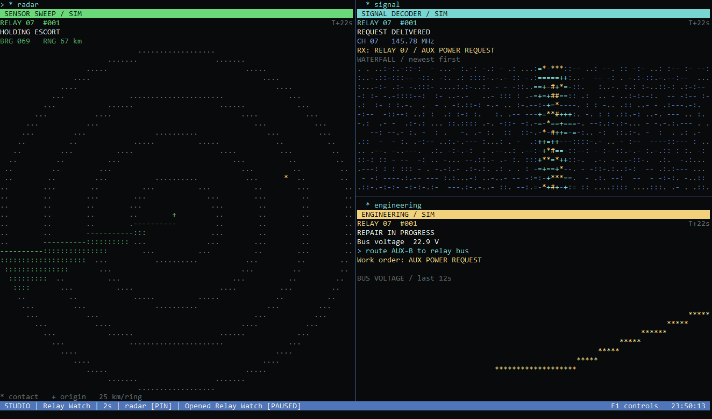

# Technobabble

Making your terminal look like it's doing something important.

Technobabble turns your terminal into an animated wall of diagnostics. Classic Mode reshuffles the panes. In Studio Mode, choose and save your own mix of live system monitors and fictional instruments.

<a name="download-v113"></a>
<a name="download-v1131"></a>

## Download v1.13.2

- **[Download for Debian or Ubuntu (64-bit)](https://github.com/lordtempis/technobabble/releases/download/v1.13.2/technobabble_1.13.2-2_amd64.deb)** · [Install the .deb](#debian-and-ubuntu-deb) · [Package checksum](https://github.com/lordtempis/technobabble/releases/download/v1.13.2/technobabble_1.13.2-2_amd64.deb.sha256)
- **[Download for Windows (ZIP)](https://github.com/lordtempis/technobabble/releases/download/v1.13.2/Technobabble-1.13.2.zip)**
- **[Download for Linux (portable x86-64 binary, .tar.gz)](https://github.com/lordtempis/technobabble/releases/download/v1.13.2/technobabble-1.13.2-linux-x64.tar.gz)** · [Portable checksum](https://github.com/lordtempis/technobabble/releases/download/v1.13.2/technobabble-1.13.2-linux-x64.tar.gz.sha256)
- [Download the Linux source archive (.tar.gz)](https://github.com/lordtempis/technobabble/releases/download/v1.13.2/Technobabble-Linux-1.13.2-source.tar.gz)
- [SHA-256 checksums for v1.13.2](https://github.com/lordtempis/technobabble/releases/download/v1.13.2/v1.13.2-SHA256SUMS)

Windows includes a desktop app and a terminal app. The native x86-64 Linux app runs on Debian, Ubuntu (including WSL 2), and compatible glibc distributions. [Watch 27 seconds of Relay Watch](docs/images/relay-watch-demo.gif) or [see the screenshot](#classic-and-studio-modes).

## Quick install

### Debian and Ubuntu (.deb)

On 64-bit Intel/AMD Debian or Ubuntu, including Ubuntu under WSL, [download the .deb](https://github.com/lordtempis/technobabble/releases/download/v1.13.2/technobabble_1.13.2-2_amd64.deb). Open a terminal in the folder where you saved it and run:

```sh
sudo apt install ./technobabble_1.13.2-2_amd64.deb
```

The package includes .NET. Run `technobabble` for Classic or `technobabble --layout "Relay Watch"` for Studio. Press **Q** to quit. To uninstall, run `sudo apt remove technobabble`.

<a name="debian-and-ubuntu-apt"></a>

#### Optional APT repository for updates

If you want future Technobabble releases through `apt upgrade`, add the signed repository once. You can do this any time after installing the `.deb`.

```sh
sudo install -d -m 0755 /etc/apt/keyrings
sudo curl -fsSL https://raw.githubusercontent.com/lordtempis/technobabble/main/linux/apt/technobabble.asc -o /etc/apt/keyrings/technobabble.asc
sudo curl -fsSL https://raw.githubusercontent.com/lordtempis/technobabble/main/linux/apt/technobabble.sources -o /etc/apt/sources.list.d/technobabble.sources
sudo chmod 0644 /etc/apt/keyrings/technobabble.asc /etc/apt/sources.list.d/technobabble.sources
sudo apt update
```

For future updates, run `sudo apt update` followed by `sudo apt upgrade`. If you skipped the `.deb` download, you can now install by name with `sudo apt install technobabble`.

The archive key fingerprint is `A533 F774 E961 CCB6 FDA0 0A90 B588 F42F 73E5 1C2D`. The source definition limits this key to the Technobabble repository.

### Windows

Download the Windows ZIP above and choose **Extract All**. In the extracted folder, double-click `Technobabble.exe` to open Classic Mode in a desktop window. For Studio in your terminal, open a PowerShell tab in Windows Terminal, switch to the extracted folder, and run:

```powershell
.\Technobabble-Terminal.exe --layout "Relay Watch"
```

Both executables use Windows performance counters. They were tested on Windows 11 with .NET Framework 4.8. Press **Q** to quit the terminal app or close the desktop window to exit.

### Linux (portable)

Use the portable archive on Intel/AMD 64-bit Linux with glibc 2.27 or later, ICU, and OpenSSL. It bundles .NET and runs directly from your user directory. Download the portable binary and its checksum above, then run these commands in the download directory.

```sh
sha256sum -c technobabble-1.13.2-linux-x64.tar.gz.sha256
tar -xzf technobabble-1.13.2-linux-x64.tar.gz
cd technobabble-1.13.2-linux-x64
./technobabble --layout "Relay Watch"
```

Use `./technobabble` for Classic Mode. Keep the extracted folder together. Alpine (musl) and ARM machines require a different build.

## Classic and Studio modes

Launch either edition without switches for Classic Mode. Try `--layout "System Watch"` for live monitoring or `--layout "Blank Canvas"` to build a dashboard from one pane.

Some panes show real system activity. Others tell a fictional story. In **Relay Watch**, radar detects a contact, a signal decoder receives its request, and engineering repairs the fault. All three follow the same incident even if you add a pane halfway through.



## Terminal controls

Run `man technobabble` for command-line options, keyboard controls, layout locations, and examples. The [terminal manual](linux/man/technobabble.1) ships in Debian package `1.13.1-3` and later.

| Key | Action |
| --- | --- |
| **S** | Switch between Classic and Studio. The desktop edition uses **F2**. |
| **Space** | Pause or resume. |
| **Tab**, **E** | Select a Studio pane, then open its editor to replace, split, or remove it. |
| **P**, **B** | Pin a pane or resize its dividers. |
| **W**, **L** | Save or open a Studio layout. The desktop uses **F5** and **F6**. |
| **Y** | On the Studio code pane, cycle through scrolling and three typing speeds. |
| **?**, **Q** | Show terminal controls or quit. |

## Source and releases

The [Windows guide](windows/README.txt) and [Linux guide](linux/README.md) cover platform-specific commands, data sources, and layout locations. Both editions read the same layout file formats. The [contributor guide](CONTRIBUTING.md) shows how to build, test, and package each from a checkout. The [v1.13.2 release notes](docs/releases/v1.13.2.md) list the downloadable artifacts and their checksums.

Technobabble is an independent recreation of [Dustin Kirkland’s Hollywood](https://github.com/dustinkirkland/hollywood). The application source is licensed under [Apache 2.0](LICENSE). The [notices](NOTICE) credit the upstream map, soundwave animation, and FIGlet font.
